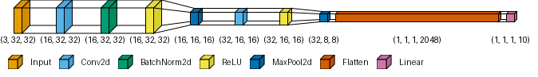
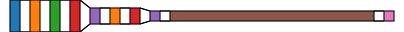
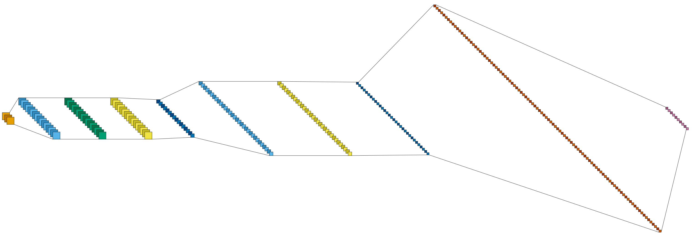
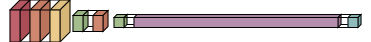
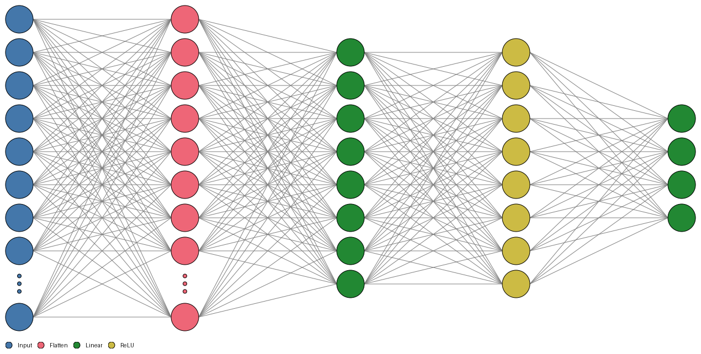
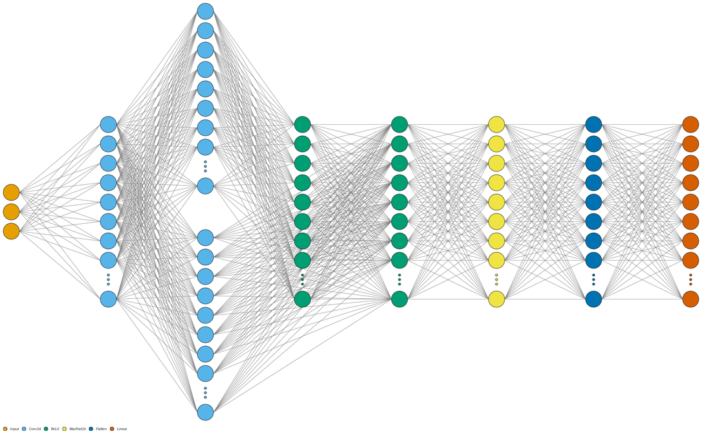

# TorchForge

A drag-and-drop canvas for assembling PyTorch architectures — including
real branching (skip-connections via Add/Concat merges), live shape
inference, architecture-diagram export (via the real
[`visualtorch`](https://github.com/willyfh/visualtorch) package), and
training with live loss/accuracy streamed to the browser — with a
**real compiler underneath it**: once a model is trained, TorchForge
compiles its trailing Linear/ReLU layers into actual CUDA kernels
through [NeuroCUDA](compiler/), a small from-scratch compiler for a
tensor DSL, and verifies the GPU output against PyTorch's own forward
pass.

```
TorchForge/
  compiler/   NeuroCUDA: NeuroLang -> CUDA C++ compiler (see compiler/README.md)
  webapp/     the drag-and-drop canvas + training UI (FastAPI + React/React Flow)
```

## Diagram gallery

Every image below is a real, generated diagram of an architecture built
through TorchForge's own DAG builder (`webapp/backend/app/graph.py` +
`app/layers.py`), rendered via `visualtorch` — not hand-drawn or
sourced from elsewhere.

| | |
|---|---|
| **3D volumetric, legend + output shapes**<br>`style="flow"`, `legend=True`, `show_dimension=True`<br> | **Flat 2D, custom palette**<br>`style="flow"`, `draw_volume=False`, `palette="tab10"`<br> |
| **LeNet style**<br>`style="lenet"`<br> | **Hide activation layers**<br>`style="flow"`, `hide_activations=True`, `palette="nord"`<br> |
| **Neuron-level detail**<br>`style="graph"`, a tiny Linear/ReLU/Linear model<br> | **Skip connection (Add-merge branch)**<br>`style="graph"`, two Conv2D branches merged back together<br> |

Every style/legend/palette/flat-vs-3D/hide-activations option above is
a live toggle in the webapp's "Diagram options" panel, not just a
backend capability — see `/api/diagram_options` and
`webapp/frontend/src/components/TrainPanel.jsx`.

## Two halves, one honest integration

**`compiler/`** is a real, deterministic compiler: lexer → parser →
semantic analysis → IR → optimizer (constant folding, fusion) → CUDA
code generator → `nvcc` → GPU execution. No LLM is involved in any of
that. It's the same NeuroCUDA built for a Principles of Compiler Design
assignment, with one addition made for this integration: a `load(path)`
op that reads real external data (e.g. trained weights) into a tensor,
instead of only `random`/`zeros`.

**`webapp/`** is the visual builder: drag layers onto a canvas, connect
them (including branches, via Add/Concat merge layers), train on a
preloaded torchvision dataset, and export either a minimal standalone
PyTorch script or an architecture diagram.

**The honest part:** NeuroCUDA v1 has no convolution kernels and no
autograd — it cannot run an entire CNN's forward pass, let alone train
one. So after a model finishes training (on PyTorch, as normal), the
webapp looks for the model's trailing run of Linear/ReLU layers (a
standard classifier "head"), and if one exists:

1. dumps that suffix's *already-trained* weights and one real batch of
   entry activations to `.nct` files,
2. generates real NeuroLang source referencing them with `load(...)`,
3. runs it through NeuroCUDA's actual compiler pipeline — the same
   lexer/parser/semantic/IR/optimizer/codegen `python -m src.cli run`
   uses — compiles with `nvcc`, and executes the resulting kernels on
   the GPU,
4. compares the result against PyTorch's own forward pass for that
   same suffix, within a stated tolerance.

If no eligible suffix exists (e.g. the model ends in a Conv2d or a
merge layer), the UI says so plainly — "0 layers accelerated" — rather
than fabricating a result. See `webapp/backend/app/neurocuda_bridge.py`.

Verified for real on an RTX 3050: a residual (Add-merge) architecture
trained to 92.4% on MNIST in one epoch, with its 3-layer Linear/ReLU
head compiled and run through NeuroCUDA, matching PyTorch's own output
to within 3.2e-5.

## Running it

Both halves share the same Python environment (already has
`torch`/`torchvision`/`fastapi`/`uvicorn`/`visualtorch` installed — no
separate venv, to avoid accidentally installing a CPU-only PyTorch
build in an isolated environment).

```bash
# Backend (FastAPI + PyTorch + the NeuroCUDA bridge), from webapp/backend/
python -m uvicorn app.main:app --reload --port 8000

# Frontend (Vite + React + React Flow), from webapp/frontend/
npm install   # first time only
npm run dev
```

Open the printed Vite URL (e.g. `http://localhost:5173`). `nvcc` and an
NVIDIA GPU are needed for the NeuroCUDA acceleration step and for
`compiler/`'s own `run`/`ask` commands; everything else (building
architectures, training on PyTorch, diagrams, code export) works
without a GPU.

**Try it in one click:** two "Load example" buttons in the header load
a complete, working architecture onto the canvas, so you can hit Train
immediately instead of building something from scratch first:

- **Simple CNN (MNIST)** — a plain sequential conv/relu/pool ×2 →
  dense head, no branching. 96.2% validation accuracy in one epoch;
  its 3-layer Linear/ReLU head compiled and ran through real NeuroCUDA
  CUDA kernels, matching PyTorch to within 8.6e-6.
- **Residual branch (MNIST)** — the Add-merge skip-connection model
  described above (92.4% on MNIST, NeuroCUDA-verified to 3.2e-5).

See `webapp/frontend/src/examples.js`.

To use NeuroCUDA on its own, as a standalone compiler:

```bash
cd compiler
python -m src.cli explain examples/demo.nl
python -m src.cli run examples/demo.nl
python -m unittest discover -s tests    # 74 tests
```

And the webapp's own test suite:

```bash
cd webapp/backend
python -m unittest discover -s tests    # 25 tests, including a real GPU bridge run
```

## What's genuinely new here vs. the standalone NeuroCUDA compiler

- **Branching architectures.** The canvas resolves an arbitrary DAG
  (not just a linear chain): any layer may fan out to multiple
  downstream layers, and `add_merge`/`concat_merge` layers fan two
  branches back in. Shape inference, the trained model (a real
  `nn.Module` with an explicit `forward()`, not just `nn.Sequential`),
  and the exported minimal code all handle this correctly — see
  `webapp/backend/app/graph.py` and `app/layers.py`.
- **Architecture diagrams** via the real `visualtorch` PyPI package
  (`webapp/backend/app/diagram.py`), not a custom renderer — with
  style (flow/graph/lenet), legend, output-shape labels, color palette,
  flat-vs-3D, and hide-activation-layers all exposed as live UI toggles.
  See the [gallery](#diagram-gallery) above.
- **`load("path.nct")`** in NeuroLang itself (`compiler/src/`), the
  piece that makes compiling *trained* weights through real CUDA
  kernels possible, rather than only ever compiling fresh random data.
- **The NeuroCUDA bridge** (`webapp/backend/app/neurocuda_bridge.py`),
  tying the two halves together honestly, as described above.

## Known limitations (by design, not oversight)

- Branching support is for Add/Concat merges of exactly two inputs
  each — not arbitrary N-ary merges.
- NeuroCUDA acceleration only ever covers the trailing Linear/ReLU
  suffix (optionally followed by a LogSoftmax, which stays on
  PyTorch) — it does not and cannot cover convolution, pooling,
  batchnorm, or any branching, since NeuroCUDA v1 has no kernels or
  autograd for those.
- No model save/load across sessions, no resuming a stopped training
  run, no auth (this is a local dev tool, not deployed publicly).
